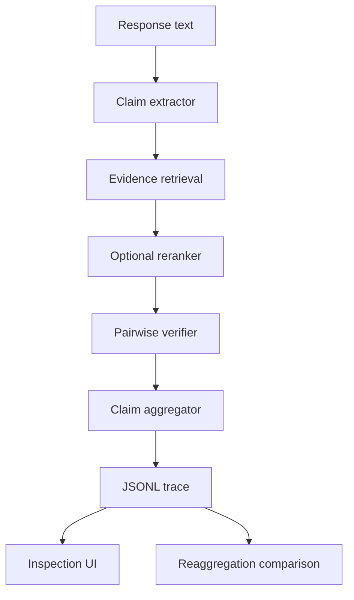

# Nullius
### Inspect how a claim-verification pipeline reaches its verdict

Nullius is a local **research inspection harness** for people studying hallucination detection and evidence-based verification. It exposes extracted claims, retrieved evidence, per-pair scores and aggregation decisions so a researcher can locate failure at the stage where it happens.

**Python · FastAPI · Streamlit · BM25 / FAISS · pretrained NLI**

[Try it locally](#try-it-locally) · [Implementation map](docs/IMPLEMENTATION_MAP.md) · [S1 readiness](docs/S1_READINESS.md) · [Annotation runbook](data/eval/s1/README.md)

> Engineering components are implemented. **Scientific detection performance has not been established.** Debug corpora contain gold evidence by construction; their scores are not meaningful retrieval or hallucination-detection benchmarks. Human S1 annotation and evaluation are pending.

## Why the design is useful

A verifier scores **one claim–evidence pair**. A separate aggregator converts those pairwise scores into a claim verdict, recording its rule, explanation and decisive evidence IDs. That separation lets aggregation rules be compared on the same score snapshot without another NLI pass.



Verdicts include Supported, Contradicted, Insufficient and Abstain. Scores are uncalibrated; they are not probabilities that a response is true.

## Implemented surface

- Typed contracts, YAML component registry, provenance and corpus fingerprints.
- BM25, dense retrieval and hybrid reciprocal-rank fusion; optional cross-encoder reranking.
- spaCy sentence extraction and cached LLM decomposition; pretrained NLI, cosine and claim-only verification paths.
- Max-entailment, noisy-OR, rank-weighted, threshold/abstain and majority aggregation.
- CLI, FastAPI JSON/SSE endpoints, Streamlit inspection and independent annotation interfaces.
- Chrome MV3 extension for explicit capture/verification, tested with synthetic browser fixtures; not a published browser-store product.
- Gated S1 annotation, adjudication, gold/prediction freezing and human matching workflow. Implemented gates do not substitute for the humans and artifacts they require.

## Try it locally

Python **3.11** is the documented baseline. Create an isolated environment, then install the checked-in requirements:

```bash
git clone https://github.com/krishmannadal/Nullius.git
cd Nullius
python -m venv .venv
source .venv/bin/activate
# Windows PowerShell: .\.venv\Scripts\Activate.ps1
python -m pip install -r requirements.txt
python -m src.cli list-components
```

For the originally recorded Windows CUDA environment, install `torch==2.4.1` from the CUDA 12.1 PyTorch wheel index before the requirements. CPU execution is possible; no API key is needed for the standard local model pipeline. The spaCy model wheel is already listed in requirements. `requirements.lock.txt` records the historical environment; it is not proof of fresh cross-platform resolution.

Full inference loads external pretrained spaCy/retrieval/NLI assets. A small checked-in corpus does **not** mean a first run is model-download-free. A fresh full dependency install was not validated in this refresh.

### Inspect one example

```bash
python -m src.cli analyze --config configs/mini.yaml --text "Marie Curie was born in Warsaw." --json
```

This is an **example command**, not a claimed benchmark result. Inspect the retrieved sentences, pairwise scores, aggregation explanation and raw trace. `configs/mini.yaml` selects a 40-document debug corpus built for inspection. To process its shipped examples:

```bash
python -m src.cli run --config configs/mini.yaml --limit 14
```

### Use the API and UI

Start the backend from the repository root:

```bash
python -m uvicorn src.api.app:app --host 127.0.0.1 --port 8000
```

Open `http://127.0.0.1:8000/docs`. In another terminal, with the same environment active:

```bash
python -m streamlit run src/ui/app.py
```

Use the Streamlit URL printed in the terminal. The UI's default backend is `http://127.0.0.1:8000`. A request example:

```bash
curl -X POST http://127.0.0.1:8000/analyze \
  -H "Content-Type: application/json" \
  -d '{"text":"Marie Curie was born in Warsaw."}'
```

No public demo endpoint is provided. This is a trusted local-operator service, without production authentication.

<details>
<summary>Endpoints, extension and research workflow</summary>

| Endpoint | Purpose |
| --- | --- |
| `GET /health` | Runtime diagnostics |
| `POST /analyze` | Standard retrieved pipeline |
| `POST /analyze/oracle` | Explicit gold-evidence substitution for diagnosis |
| `POST /verify/quick` | Extraction/retrieval availability, not a truth judgment |
| `POST /verify/full` | Full JSON or SSE execution |
| `POST /annotate` | Structured annotation records |

The backend accepts optional `NULLIUS_EXTENSION_IDS` (comma-separated Chrome IDs) for explicit extension origins. Follow [extension packaging](docs/extension-package.json) and [API details](docs/api.md); authenticated live ChatGPT capture was not established by fixture tests.

The [S1 runbook](data/eval/s1/README.md) is authoritative for annotation. Two independent annotators, adjudication, frozen gold, real provider outputs and human system-to-gold matching are required before scientific metrics. Do not promote synthetic fixtures or template files into evidence. Protocol provenance is explicitly limited in [S1 readiness](docs/S1_READINESS.md).

</details>

## Verification and limitations

The 23 October 2026 documentation audit independently ran **124 core tests** across types, configuration, aggregators and corpus handling: 124 passed, zero skipped. This does not exercise model downloads, NLI inference, live extension capture or full end-to-end detection.

[S1_READINESS.md](docs/S1_READINESS.md) records an earlier **437-test** developer run in a cached Windows environment. That is historical engineering evidence, not a fresh full-suite reproduction or a scientific benchmark.

The mini corpus and FEVER-derived debug corpus were assembled with gold evidence present. Retrieval difficulty, natural claim distribution and calibrated uncertainty remain unresolved. No headline accuracy/F1 is claimed.

Next: complete independent annotation and adjudication; freeze provenance; run real provider/baseline outputs; then evaluate extraction under the stated pilot protocol. Full-corpus retrieval and end-to-end detection require separate studies.

<details>
<summary>Tests and optional FEVER data</summary>

```bash
python -m pytest -rs
python -m playwright install chromium
python -m scripts.build_mini_corpus
```

Browser dependencies/assets are required for extension/UI tests. Inspect reported skips instead of counting them as passes. See [data documentation](docs/data-fever.md) for the optional FEVER download and rebuild; it is not required to use the tracked mini corpus.

`src/core/`: contracts/configuration; `src/components/`: methods; `src/service.py`: shared orchestration; `src/api/`: HTTP; `src/ui/`: inspection; `src/eval/`: gated research workflow; `tests/`: regression and contract checks.

</details>

## Credits and licensing

Repository history records work by Krishmannadal/krishna. Third-party pretrained components and FEVER data retain their own terms; see [data-fever.md](docs/data-fever.md) and component documentation for sources. No repository-level license file is present. No license is added or implied by this README.
